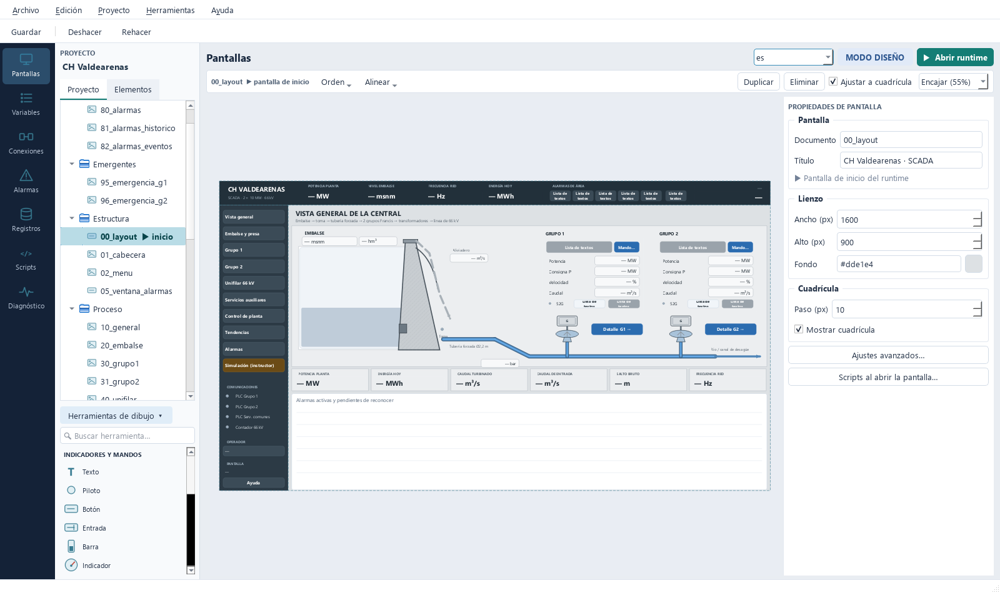

# abSCADA

SCADA de escritorio libre (GPL-3.0-or-later) hecho con Python y PySide6. **Studio** diseña el proyecto y **Runtime** lo opera en otra ventana. Comunica con Siemens S7, Modbus TCP, Beckhoff TwinCAT ADS y OPC UA, y tiene usuarios y roles, alarmas, históricos SQLite, tendencias y scripts Python. Los proyectos son carpetas de JSON con un manifiesto `.abscada`.



## Instalar

Requiere Python 3.11 o posterior y una sesión gráfica.

```powershell
git clone https://github.com/adriansmas/abscada.git
cd abscada
python -m venv .venv
.venv\Scripts\python -m pip install -e ".[dev,s7,modbus,opcua]"
.venv\Scripts\python -m abscada
```

En macOS o Linux, usa `.venv/bin/python`. Linux necesita las bibliotecas de sistema de Qt. Solo está verificado en Windows; CI prueba Windows y Linux.

Para Windows hay también un ejecutable en [Releases](https://github.com/adriansmas/abscada/releases): se descomprime y se ejecuta `abscada.exe` ([guía de la beta](docs/BETA.md)).

## Probar un ejemplo

Sin argumentos se abre la pantalla de inicio. Elige un ejemplo con **Arrancar también su PLC simulado** (se copia a Documentos) y en Studio pulsa **Abrir runtime**.

| Ejemplo | Qué enseña |
| --- | --- |
| [Central hidroeléctrica](examples/hydro/README.md) | Proceso continuo: secuencias, protecciones, varios PLC S7 y Modbus, varios monitores |
| [Cervecería La Tolva](examples/brewery/README.md) | Proceso por lotes: recetas, OPC UA cifrado, usuarios y roles, servidor OPC UA |
| [Banco Beckhoff](examples/beckhoff/README.md) | TwinCAT ADS sin instalar TwinCAT en el puesto |
| [Laboratorio](examples/showcase/README.md) | Todos los controles, librerías, gráficas, alarmas y scripts sobre S7 y Modbus |

Desde la línea de comandos:

```powershell
.venv\Scripts\python -m abscada --simulador hydro      # en otra terminal
.venv\Scripts\python -m abscada examples/hydro         # Studio
.venv\Scripts\python -m abscada examples/hydro --runtime   # solo Runtime
```

Runtime trabaja sobre una copia del proyecto: lo que guardes en Studio se aplica al reiniciarlo. Sin PLC, las variables enlazadas tienen calidad mala; abSCADA nunca inventa lecturas.

## Documentación

| Guía | Contenido |
| --- | --- |
| [Studio](docs/STUDIO.md) | Diseñar pantallas, variables, alarmas, registros, librerías, idiomas y guardar |
| [Operación](docs/OPERATIONS.md) | Runtime: mandos, alarmas, históricos, tendencias y almacenamiento |
| [Scripts](docs/SCRIPTS.md) | Scripts Python y la API `ctx` |
| [Protocolos](docs/PROTOCOLS.md) | Conexiones, direcciones y límites de S7, Modbus, ADS y OPC UA |
| [Formato de proyecto](docs/PROJECT_FORMAT.md) | Referencia de los JSON del proyecto y de las librerías |
| [Bastionado](docs/HARDENING.md) | Instalar abSCADA de forma segura en planta |
| [Desarrollo](docs/DEVELOPMENT.md) | Arquitectura, pruebas, añadir protocolos o controles, traducir y publicar versiones |
| [Desarrollo seguro](docs/SECURITY_DEVELOPMENT.md) | IEC 62443-4-1, CRA y modelo de amenazas |
| [Pendientes](docs/PENDIENTES.md) | Lo que falta |

[CHANGELOG.md](CHANGELOG.md) recoge los cambios por versión y [SECURITY.md](SECURITY.md) cómo informar de vulnerabilidades.

## Límites

abSCADA está en beta: no se ha validado con PLC físicos ni bajo carga sostenida. Los scripts son código de confianza; su proceso separado no es una sandbox. abSCADA no sustituye las protecciones ni las funciones de seguridad del PLC.

Código propio bajo [GPL-3.0-or-later](LICENSE). La licencia del motor no determina la de los proyectos de usuario.
