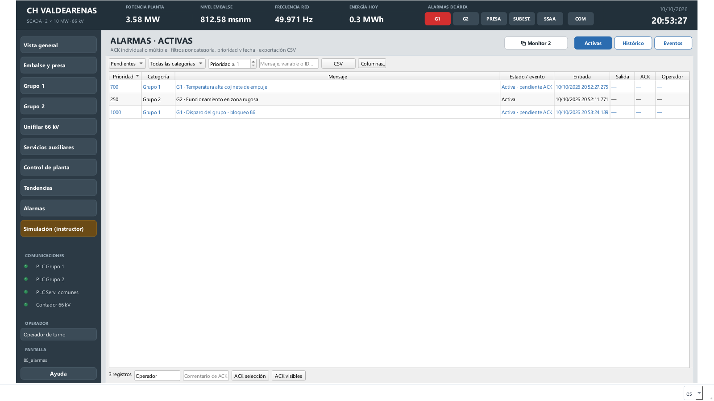
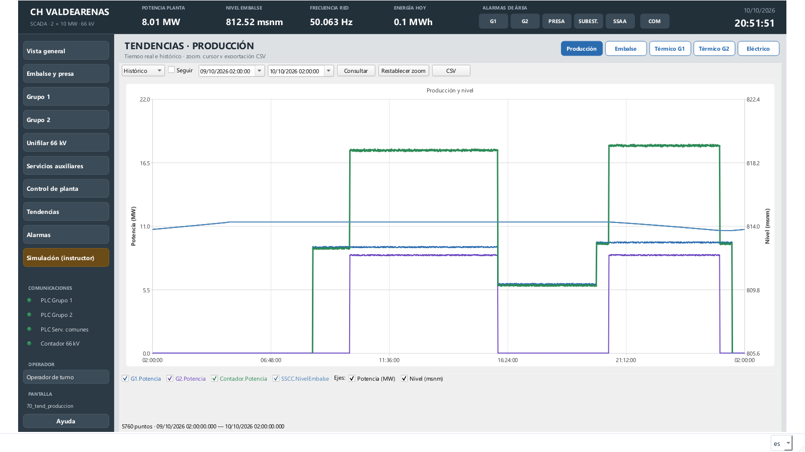

# Guía de operación

Cómo se comporta Runtime: mandos, alarmas, registro, tendencias y almacenamiento. Cómo se configura todo esto está en [STUDIO.md](STUDIO.md) y los scripts en [SCRIPTS.md](SCRIPTS.md).

## Ventanas y sesión

La ventana principal, sus contenedores y las emergentes comparten comunicaciones, idioma, sesión, alarmas y registros. Runtime solo añade controles comunes de sesión, idioma y diagnóstico; la navegación de proceso la hacen los botones de las pantallas.

Con usuarios y roles activados, hay que iniciar sesión para dar órdenes, cambiar consignas, ejecutar scripts de botón y reconocer alarmas, y cada acción queda a nombre del usuario. Sin seguridad, el nombre de operador es texto libre y no acredita identidad.

## Órdenes

Una escritura comprueba tipo, permiso y calidad, y entra en la cola de su conexión. Que se envíe no confirma el estado físico: el valor se actualiza con la siguiente lectura. Las órdenes que no se pudieron enviar se descartan y no se repiten al reconectar.

Los pulsadores momentáneos y press/release envían la liberación al soltar, perder el foco, navegar, cerrar o deshabilitarse el control, y la mala calidad cancela el gesto. Al cerrar se esperan hasta 2 s las liberaciones pendientes. Una caída de red o de alimentación puede impedir la liberación: **el PLC debe implementar el tiempo máximo y los permisos de esas órdenes**.

## Alarmas

Cada activación crea una **ocurrencia** y cada transición un **evento**. Si una alarma vuelve a entrar tras retornar, crea otra ocurrencia aunque la anterior siga pendiente de ACK.

| Estado | Condición | Reconocimiento |
| --- | --- | --- |
| Activa · pendiente ACK | Activa | Pendiente |
| Activa | Activa | Reconocida o sin ACK |
| Retornada · pendiente ACK | Inactiva | Pendiente |
| Cerrada | Inactiva | Reconocida o sin ACK |

**Condiciones.** Digitales: true/false. Numéricas: high (≥), low (≤), igual y distinto. High retorna por debajo de umbral − histéresis y low por encima de umbral + histéresis; igual y distinto no usan histéresis, así que para flotantes conviene high/low. **Sin datos válidos** (`bad_quality`), para cualquier variable simple, incluida string: salta mientras la calidad no es `good` (equipo sin comunicación, o un script que la marca con `ctx.set_quality`) y retorna con el primer dato bueno. No usa umbral ni histéresis; el retardo de entrada evita avisar por cortes breves.

**Retardos.** La condición debe mantenerse el tiempo configurado. En las demás condiciones, una lectura bad o uncertain cancela los retardos pendientes y **conserva** el estado de las alarmas activas: perder la comunicación no es un retorno del proceso. Para avisar de esa pérdida, añade una alarma *Sin datos válidos* sobre la misma variable.

**ACK.** Guarda fecha, operador y comentario. No escribe al PLC ni cambia la condición. Se puede reconocer una, varias o todas las visibles, y repetir un ACK no añade eventos.

**Reinicio.** Los estados activos y los ACK se recuperan de SQLite; los retardos pendientes no. Eliminar o deshabilitar una alarma no borra sus ocurrencias: las activas se pueden seguir reconociendo y no se inventa su retorno.

**Visor.** Pestañas Pendientes, Activas, Histórico y Eventos. El histórico filtra por fecha de entrada y los eventos por fecha del evento. Las horas se muestran en hora local y se exportan en ISO 8601 UTC. Cada consulta devuelve como máximo 2000 filas. La columna Calidad es la calidad actual de la variable, no la de la ocurrencia.



## Registro

El ciclo de la conexión decide cada cuánto se lee el PLC. El intervalo del registro decide cada cuánto se guarda la última lectura disponible. Registrar cada 100 ms una variable que se lee cada 1000 ms repite el mismo valor con su hora de adquisición original; no genera lecturas nuevas.

Cada fichero de registro tiene su propio ciclo y guarda en cada uno todas sus variables con valor, calidad, hora de registro y hora de recepción (la del Runtime, no la del PLC). No interpola ni depende de que haya una tendencia abierta, y no garantiza capturar cambios más breves que su intervalo.

## Tendencias

- **Tiempo real** toma muestras cada 200 ms y guarda en memoria hasta 50000 por variable. Ese búfer se pierde al cambiar de pantalla.
- **Histórico** consulta los SQLite de los días elegidos.

**Seguir** desplaza la ventana de tiempo; desactivado, permite elegir inicio y fin. El cursor muestra la muestra más cercana de cada curva con su calidad. La calidad mala corta la curva y las variables bool se dibujan escalonadas.

Las consultas grandes se reducen a unos 5000 puntos por curva conservando extremos, primer y último dato y huecos de calidad. El CSV del histórico exporta los datos originales, hasta 100000 registros; en tiempo real exporta el búfer.



## Almacenamiento

```text
runtime/
  scada.sqlite3                # alarmas, eventos y auditoría
  records/<registro>/
    2026-10-01.sqlite3         # un archivo por registro y día UTC
```

- Solo se crean archivos para días con muestras. Las consultas recorren los días necesarios e incluyen los registros retirados: quitar una variable de un registro no borra su pasado.
- SQLite en modo WAL con `synchronous FULL`; los lotes se confirman cada 200 ms y el ACK antes de responder al operador. Una caída abrupta puede perder el último lote.
- Un único escritor por proyecto: un bloqueo de archivo impide arrancar dos Runtime sobre la misma carpeta.
- Cola llena, error SQLite o disco lleno aparecen en la barra de estado. Tras un fallo de archivo, corrige la causa y reinicia Runtime.
- La retención se aplica al arrancar y cada hora: borra los días caducados y las ocurrencias cerradas antiguas, nunca las activas o pendientes de ACK. Borrar datos no reduce el tamaño del archivo; no ejecutes VACUUM durante la adquisición.
- Usa almacenamiento local. Para copiar en caliente, usa **Herramientas → Copia de seguridad de los registros**: copiar solo el `.sqlite3` puede perder lo que aún está en el WAL.

## Auditoría

Se registran el arranque y la parada de Runtime, inicios y cierres de sesión, intentos fallidos, cada orden con su usuario y su origen (HMI, OPC UA o script), las órdenes denegadas y si se enviaron o fallaron. La auditoría todavía no es inmutable ni está firmada.
