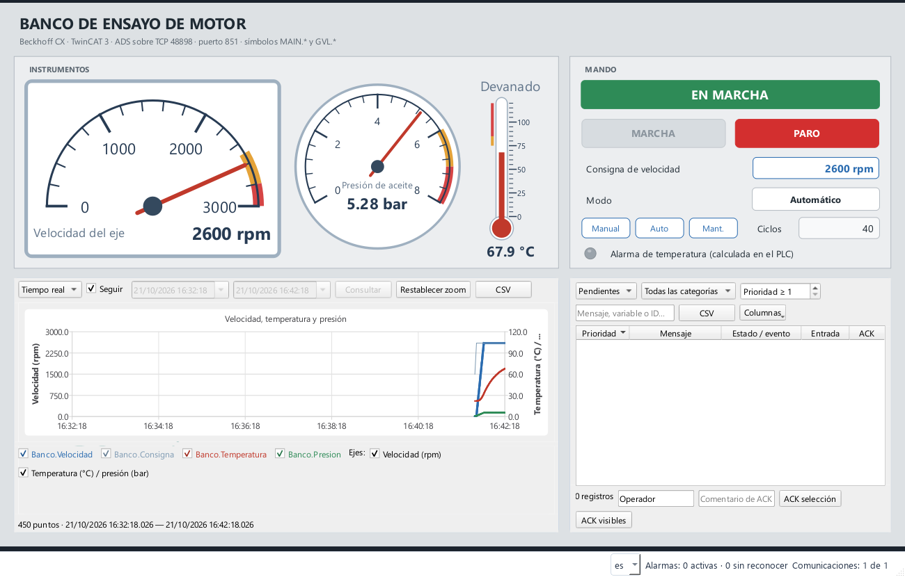

# Banco de ensayo Beckhoff · TwinCAT ADS

Banco de ensayo de motor sobre un PLC Beckhoff (CX, IPC o TwinCAT en un PC) por **ADS**: indicadores de aguja, mando, tendencia y alarmas.



## Arrancar

Desde la pantalla de inicio, con **Arrancar también su PLC simulado**. O en dos terminales:

```powershell
.venv\Scripts\python -m abscada --simulador ads
.\run.ps1 examples/beckhoff
```

Pulsa **MARCHA** y cambia la consigna: el eje acelera y el devanado se calienta; por encima de 85 °C salta `GVL.bAlarmaTemperatura`. Si TwinCAT está instalado en este PC, su router ocupa el puerto 48898: arranca el simulador con `--port 48899` y cambia el puerto en **Conexiones**.

| Variable SCADA | Símbolo del PLC | Tipo | Acceso |
| --- | --- | --- | --- |
| Banco.Marcha | `MAIN.bMarcha` | BOOL | Lectura/escritura |
| Banco.Modo | `MAIN.nModo` | INT | Lectura/escritura |
| Banco.Consigna | `MAIN.rConsignaVelocidad` | REAL | Lectura/escritura |
| Banco.Velocidad / Temperatura / Presion | `MAIN.rVelocidad` / `rTemperatura` / `rPresion` | REAL | Lectura |
| Banco.Ciclos | `MAIN.nCiclos` | DINT | Lectura |
| Banco.Estado | `MAIN.sEstado` | STRING(40) | Lectura |
| Banco.AlarmaTemperatura | `GVL.bAlarmaTemperatura` | BOOL | Lectura |

## Conectar un PLC real

abSCADA habla ADS por TCP: **no necesita TwinCAT ni el router ADS en el puesto SCADA**. A cambio, el PLC debe tener una ruta hacia el SCADA.

1. Anota la IP y el **AMS Net ID** del PLC (*SYSTEM → Routes* en TwinCAT; suele ser la IP + `.1.1`).
2. En el PLC, añade una **ruta estática** (TwinCAT XAE *Add Route* o `StaticRoutes.xml`) con el AMS Net ID del puesto SCADA (por defecto su IP + `.1.1`), su IP y transporte TCP/IP.
3. Permite TCP 48898 entrante en el PLC.
4. En Studio, **Conexiones → Añadir → Beckhoff TwinCAT ADS**: IP y AMS Net ID del PLC, puerto TCP 48898, puerto ADS **851** (TwinCAT 3) u **801** (TwinCAT 2) y AMS Net ID local `auto` o el de la ruta.
5. En **Variables → Enlace…**, escribe el símbolo tal como aparece en TwinCAT (`MAIN.rVelocidad`, `GVL.aMotores[2].bMarcha`) y su tipo.

Si el puesto SCADA también tiene TwinCAT, usa otro AMS Net ID local (por ejemplo `192.168.1.20.1.2`) y créale la ruta. El PLC debe estar en RUN; si no, la conexión pasa a calidad *bad*. Tipos, direcciones sin símbolo y límites: [PROTOCOLS.md](../../docs/PROTOCOLS.md#twincat-ads).

Regenerar: `tools/build_beckhoff.py --force` (conserva este README). Pruebas: `tests/test_ads.py`.
