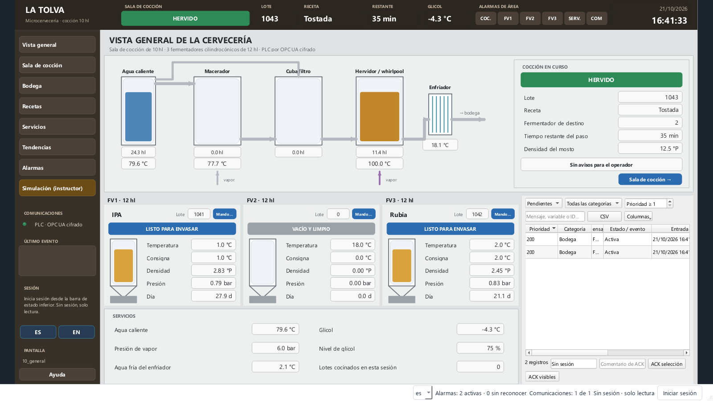

# La Tolva · microcervecería por lotes

Sala de cocción de 10 hl que trabaja por recetas, tres fermentadores y sus servicios, con un PLC simulado de cocción y fermentación. Es el ejemplo de referencia para **OPC UA cifrado**, **usuarios y roles** y el **servidor OPC UA** propio.



| | |
| --- | --- |
| Conexión | 1 PLC por OPC UA (Basic256Sha256, firma y cifrado) |
| Seguridad | 5 roles, 4 cuentas de demostración; el editor de recetas exige el permiso `recipes` |
| Contenido | 19 pantallas, 156 variables, 35 alarmas, 3 registros, 11 tendencias y 4 scripts |

## Arrancar

Desde la pantalla de inicio, con **Arrancar también su PLC simulado**. O en dos terminales (requiere el extra `opcua`):

```powershell
.venv\Scripts\python -m abscada --simulador cerveceria
.\run.ps1 examples/brewery
```

**La primera conexión falla a propósito**: el certificado del PLC queda en *Rechazados* y la cabecera marca **COM** en rojo. En Studio, abre **Proyecto → Certificados OPC UA…**, comprueba que la huella coincide con la que imprime el simulador y pulsa **Confiar en el seleccionado**. El simulador guarda su certificado en `%LOCALAPPDATA%\abSCADA\simuladores\cerveceria`, así que la confianza se mantiene entre arranques.

## Cuentas de demostración

Sin sesión, el runtime funciona en solo lectura. Las contraseñas son **públicas**: cámbialas si partes de este ejemplo.

| Usuario | Contraseña | Rol | Permisos |
| --- | --- | --- | --- |
| `admin` | `Tolva-Admin-2026` | Administrador | Todos |
| `maestro` | `Tolva-Maestro-2026` | Maestro cervecero | Mandos, ACK y recetas |
| `operador` | `Tolva-Operador-2026` | Operador de cocción | Mandos y ACK |
| `mes` | `Tolva-MES-cliente` | Cliente MES | Solo lectura por OPC UA |

Hay además un rol *Observador* sin permisos.

## Operar

El tiempo está comprimido: un minuto de receta dura un segundo y un día de fermentación, un minuto.

**Cocción.** En *Sala de cocción*, elige receta y un fermentador libre y pulsa **INICIAR LOTE** (requiere vapor > 4 bar y agua caliente ≥ 70 °C). El PLC copia la receta al empezar y recorre 12 pasos: llenado, empaste (espera la confirmación de la malta), escalones de maceración, trasiego, filtrado y lavado, hervido (pide los lúpulos), whirlpool, enfriado hacia el fermentador y limpieza. **RETENER** congela la secuencia, **REANUDAR** la continúa y **ABORTAR** manda el mosto a desagüe.

**Fermentación.** Cada fermentador sigue su receta: fermentación, reposo de diacetilo, cold crash, guarda y *listo para envasar*. **Mando…** permite pasar a consigna manual o trasegar a envasado.

**Recetas.** Rubia, Tostada, IPA y Negra. Al elegir una se carga en un búfer; **GUARDAR** la copia a la receta almacenada y recorta los valores fuera de rango.

**Servidor OPC UA.** El proyecto publica todas las variables en `opc.tcp://<equipo>:4850/abscada`, con firma y cifrado y sin anónimo. Conéctate con la cuenta `mes` y confía en el certificado del cliente desde **Proyecto → Certificados OPC UA…**.

## Ejercicios (panel del instructor)

1. Como `operador`, inicia un lote de **Tostada** hacia el **FV3**, y confirma la malta y los lúpulos.
2. Durante el hervido, activa **Espuma en el hervor**: el PLC baja el vapor del 70 al 40 %.
3. Activa **Fallo de la enfriadora de glicol**: los fermentadores se desvían de consigna y saltan sus alarmas.
4. Intenta cambiar una receta como `operador`: abSCADA pide una sesión con permiso de recetas. Hazlo como `maestro`.
5. Activa **Levadura inactiva** en un fermentador: al cabo de un día (un minuto) salta *Fermentación parada*.

## Comunicaciones

| Conexión | Endpoint | Ciclo |
| --- | --- | --- |
| PLC_Cerveceria | `opc.tcp://127.0.0.1:4841/latolva` | 1000 ms |

Cada variable es el nodo `nsu=urn:latolva:plc;s=<objeto>.<campo>`, por ejemplo `nsu=urn:latolva:plc;s=FV1.Temperatura`. Las órdenes (`Orden…`) son pulsos que el PLC vuelve a poner a falso. El mapa está en `tools/plc_simulators/brewery_map.py`.

Regenerar: `tools/build_brewery.py --force` (conserva este README y `users.json`). Pruebas: `tests/test_brewery.py`.
