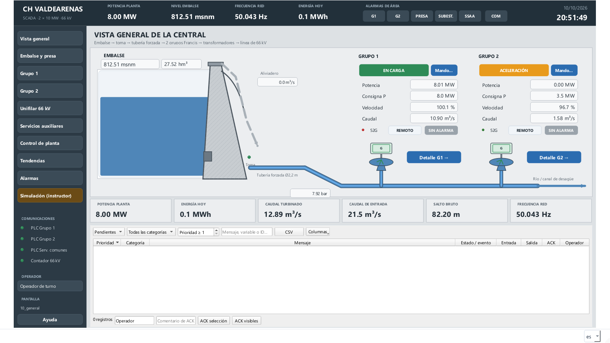

# CH Valdearenas · central hidroeléctrica

Central a pie de presa con **dos grupos Francis de 10 MW**, con un PLC simulado que reproduce la física de la planta. Es el ejemplo de proceso continuo: secuencias de arranque, protecciones, unifilar, alarmas, tendencias y varias ventanas.



| | |
| --- | --- |
| Conexiones | 3 PLC S7 (un grupo cada uno y servicios comunes) y un contador Modbus TCP |
| Contenido | 23 pantallas, 173 variables, 43 alarmas, 4 registros, 5 tendencias, 6 faceplates y 4 scripts |

## Arrancar

Desde la pantalla de inicio, con **Arrancar también su PLC simulado**. O en dos terminales:

```powershell
.venv\Scripts\python -m abscada --simulador hydro
.\run.ps1 examples/hydro
```

Sin simulador, las señales tienen calidad *bad* y la cabecera marca **COM** en rojo.

Para tener una semana de histórico **sintético** en las tendencias, ejecuta una vez con Runtime cerrado `.venv\Scripts\python tools/seed_hydro_history.py`. Los datos quedan marcados como sintéticos en la auditoría.

## Operar

**Arranque.** Con el grupo en REMOTO y *Listo para arrancar* encendido, pulsa **ARRANCAR**. El PLC recorre los pasos: auxiliares (1), válvula de entrada (2), aceleración (3), excitación (4), sincronización y cierre del 52G (5) y carga hasta la consigna (6).

**Parada.** **PARAR** descarga el grupo (7), abre el 52G y el campo (8) y frena por debajo del 20 % de velocidad (9).

**Disparo.** La parada de emergencia o cualquier protección cierra rápido y deja el grupo **bloqueado (86)**. Con el grupo parado, **REARME 86** lo devuelve a reposo. Protecciones: cojinetes de guía > 80 °C y de empuje > 85 °C, estator > 130 °C, vibración > 7,1 mm/s, aceite < 45 bar, sobrevelocidad > 115 % y pérdida de red.

**Control de planta.** El script `control_planta.py` reparte la consigna entre los grupos acoplados y, con la regulación de nivel activa, la ajusta para mantener la cota del embalse. El aliviadero abre solo a partir de 814,60 msnm.

**Ventanas.** **Mando…** abre una ventana por grupo; un clic en una bomba de *Servicios auxiliares* abre su detalle; **⧉ Monitor 2** abre las alarmas en el segundo monitor. Para arrancar ya repartido en tres monitores, configura `display` en **Proyecto → Ajustes del proyecto… → Operación** ([formato](../../docs/PROJECT_FORMAT.md#monitores)).

## Ejercicios (panel del instructor)

1. Arranca el Grupo 1 hasta **EN CARGA** y baja la consigna a 3,5 MW: entra en la zona rugosa y aparece el aviso.
2. Activa *Calentamiento de cojinete de empuje*: alarma a 75 °C y disparo a 85 °C. Reconoce, quita la avería y rearma.
3. Con los dos grupos en carga, provoca una **pérdida de red**: disparo de ambos y arranque del diésel. Restablece la red, cierra el 52L desde el unifilar y rearma.
4. Provoca una **avenida**: el aliviadero abre solo y saltan las alarmas de presa.

## Comunicaciones

Las direcciones salen de `tools/plc_simulators/hydro_map.py`, que comparten el generador y el simulador.

| Conexión | Protocolo | Dirección | Ciclo |
| --- | --- | --- | --- |
| PLC_G1 / PLC_G2 | S7 | 127.0.0.1:1102 / :1103, rack 0 slot 1, DB1 | 250 ms |
| PLC_SSCC | S7 | 127.0.0.1:1104, DB1 | 500 ms |
| Contador_66kV | Modbus TCP | 127.0.0.1:1502, unit 1, input registers | 1000 ms |

En cada grupo, `%DB1.DBX0.0`–`X0.3` son órdenes (pulsos que borra el PLC), `%DB1.DBD4` el paso de secuencia, `DBD8`/`DBD12` las consignas P y Q, y el resto lecturas. Para una planta real basta con cambiar IP y direcciones; las pantallas no cambian.

## Simplificaciones

Tiempos comprimidos (un arranque dura unos 40 s), embalse unas 200 veces más rápido y modelo didáctico. La parada de emergencia del SCADA es una orden más: las protecciones reales viven en relés y PLC.

Regenerar: `tools/build_hydro.py --force` (conserva este README). Pruebas: `tests/test_hydro.py`.
